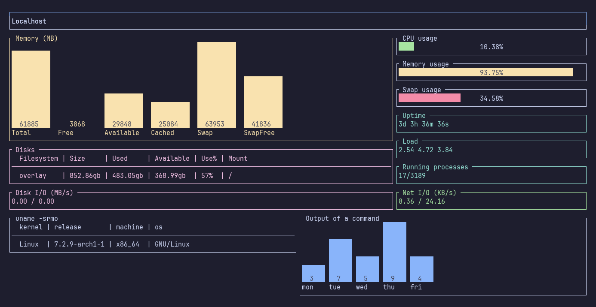
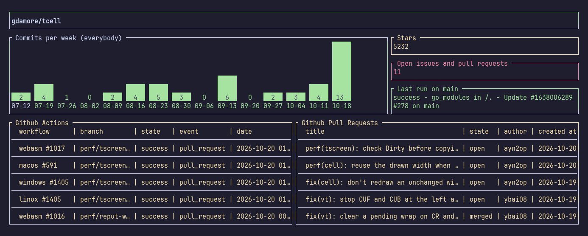
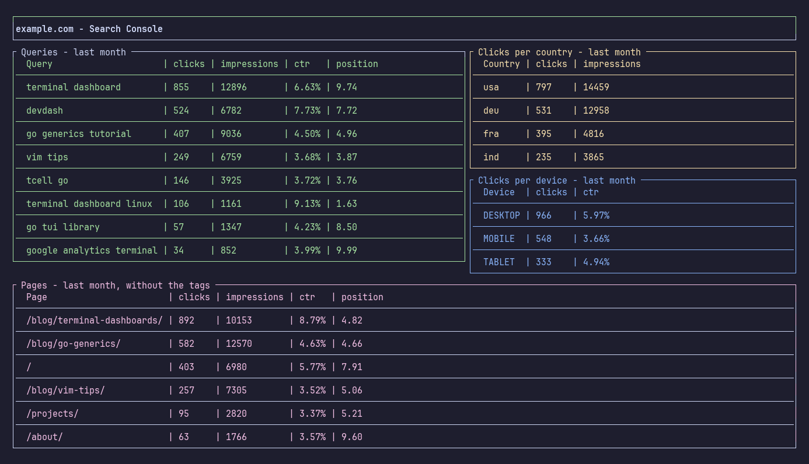
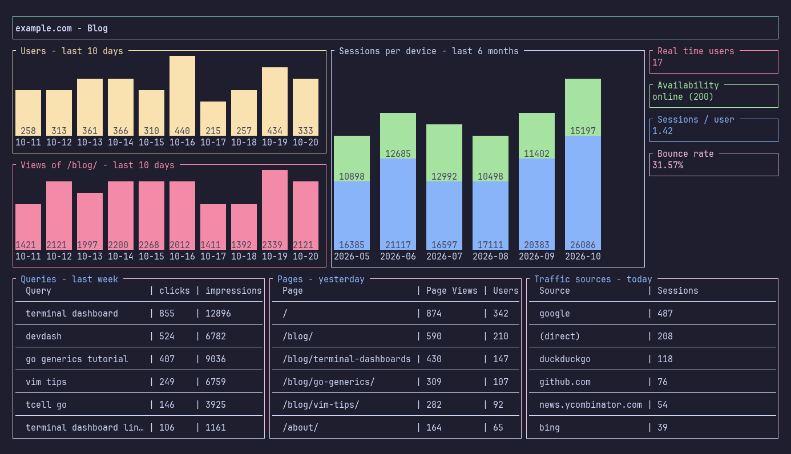

# Examples

Each example is a complete dashboard in the [`example`](../example) directory. Copy it into `$XDG_CONFIG_HOME/devdash`, replace the credentials and addresses with yours, and run `devdash -c <name>`.

The Google Analytics and Search Console screenshots show sample data.

## Default dashboard

The dashboard DevDash creates on the first run: a website's availability, and on Linux, the metrics of your computer. Its configuration is in [Getting started](./getting-started.md#your-first-dashboard).


## Localhost

[`localhost.yml`](../example/localhost.yml): the memory, CPU, disks, network and load of your computer, and the output of your own commands. It needs Linux.



## Github

[`github.yml`](../example/github.yml): commits per week, stars, branches, pull requests and repositories of a public repository, with themes. It works without a token.



## Google Analytics

[`google-analytics.yml`](../example/google-analytics.yml): users per day, sessions per month, new and returning users in a stacked bar chart, real time users, totals, and tables of pages and traffic sources.


## Google Search Console

[`search-console.yml`](../example/search-console.yml): the queries, countries, devices and pages of last month, with a filter excluding pages.



## A blog

[`blog.yml`](../example/blog.yml): Google Analytics, Google Search Console and the availability of the website together.



### Page views of chosen pages

`ga.bar_pages` displays the views of the pages containing its filter. `ga.bar` can do the same with any metric and dimension.

```yaml
projects:
  - name: example.com - Pages
    services:
      google_analytics:
        keyfile: my-keyfile.json
        property_id: 123456789
    themes:
      bar:
        start_date: 9_days_ago
        bar_width: 5
    widgets:
      - row:
          - col:
              size: M
              elements:
                - name: ga.bar_pages
                  options:
                    title: " Terminal dashboards "
                    color: blue
                    filters: "/blog/terminal-dashboards/"
          - col:
              size: M
              elements:
                - name: ga.bar
                  options:
                    title: " Users of the Go articles "
                    color: cyan
                    metric: users
                    dimensions: page_path
                    filters: "/blog/go-"
```

### Pages per day

Columns of the same widget for different days. The theme `table` sets the options common to every table.

```yaml
projects:
  - name: example.com - Pages per day
    services:
      google_analytics:
        keyfile: my-keyfile.json
        property_id: 123456789
    themes:
      table:
        metrics: page_views
        row_limit: 30
    widgets:
      - row:
          - col:
              size: S
              elements:
                - name: ga.table_pages
                  options:
                    title: " 2 days ago "
                    start_date: 2_days_ago
                    end_date: 2_days_ago
                    color: blue
          - col:
              size: S
              elements:
                - name: ga.table_pages
                  options:
                    title: " Yesterday "
                    start_date: yesterday
                    end_date: yesterday
                    color: magenta
          - col:
              size: S
              elements:
                - name: ga.table_pages
                  options:
                    title: " Today "
                    start_date: today
                    end_date: today
                    color: green
```
