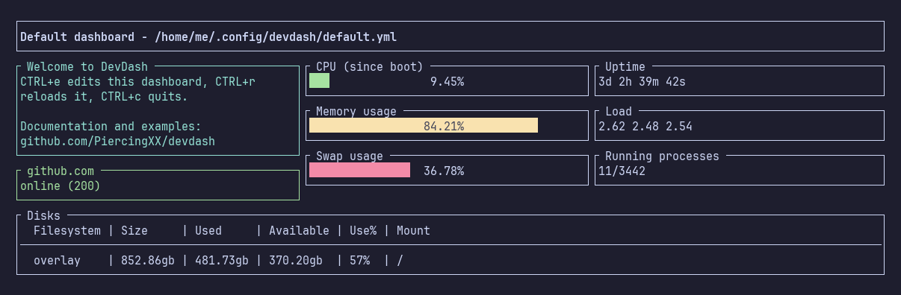

# Getting Started

## Installation

### Release binaries

Download the binary for your OS and architecture from the [latest release](https://github.com/PiercingXX/devdash/releases/latest).

### Linux script

The script downloads the latest release for Linux (x86_64 or arm64) and moves it into `/usr/local/bin` (it uses `sudo`):

```shell
curl -fsSL https://raw.githubusercontent.com/PiercingXX/devdash/master/install/linux.sh | bash
```

### With Go

With Go 1.26 or later:

```shell
go install github.com/PiercingXX/devdash@latest
```

### From source

```shell
git clone https://github.com/PiercingXX/devdash.git
cd devdash
go build .
```

## Your first dashboard

Run `devdash` without any argument. If it doesn't exist yet, DevDash creates the default dashboard `default.yml` in `$XDG_CONFIG_HOME/devdash`, and displays it:



It checks every 600 seconds that `https://github.com` answers with a status code 200. On Linux, it also displays the metrics of your computer. Press `CTRL+e` to open it in your editor: replace the address with your own website, save, and quit the editor to see the result.

```yaml
---
general:
  refresh: 600
  keys:
    quit: "C-c"
    hot_reload: "C-r"
    edit: "C-e"

projects:
  - name: Default dashboard - /home/me/.config/devdash/default.yml
    services:
      monitor:
        address: "https://github.com"
    widgets:
      - row:
          - col:
              size: 4
              elements:
                - name: display.box
                  options:
                    title: " Welcome to DevDash "
                    content: "CTRL+e edits this dashboard, CTRL+r reloads it, CTRL+c quits.\n\nDocumentation and examples:\ngithub.com/PiercingXX/devdash"
                    multiline: true
                    color: cyan
                - name: mon.box_availability
                  options:
                    title: " github.com "
                    color: green
          # Only on Linux.
          - col:
              size: 4
              elements:
                - name: lh.gauge_cpu_rate
                  options:
                    title: " CPU (since boot) "
                    bar_color: green
                - name: lh.gauge_memory_rate
                  options:
                    bar_color: yellow
                - name: lh.gauge_swap_rate
                  options:
                    bar_color: red
          - col:
              size: 4
              elements:
                - name: lh.box_uptime
                - name: lh.box_load
                - name: lh.box_processes
      - row:
          - col:
              size: 12
              elements:
                - name: lh.table_disk
```

The same kind of dashboard can be written in JSON:

```json
{
  "projects": [
    {
      "name": "Quickstart",
      "services": {
        "monitor": { "address": "https://example.com" }
      },
      "widgets": [
        {
          "row": [
            {
              "col": {
                "size": "M",
                "elements": [
                  { "name": "mon.box_availability", "options": { "border_color": "green" } }
                ]
              }
            }
          ]
        }
      ]
    }
  ]
}
```

The documentation uses YAML everywhere, but TOML works too. The [configuration reference](./configuration.md) explains each part of a dashboard.

The value of `$XDG_CONFIG_HOME` depends on your OS:

* **Linux and other Unix systems**: `~/.config`
* **macOS**: `~/Library/Application Support`
* **Windows**: `%LOCALAPPDATA%`

## Displaying a dashboard

```shell
devdash -c my_dashboard
```

With a name without extension, DevDash looks for `my_dashboard.yml` (or `.yaml`, `.json`, `.toml`) in these directories, in this order:

1. `$XDG_CONFIG_HOME/devdash/`
2. The current directory.

You can also give a relative or absolute path with its extension, for example `devdash -c ~/dashboards/blog.yml`.

## Commands

| Command                             | Description                                                                                                                                         |
| ----------------------------------- | --------------------------------------------------------------------------------------------------------------------------------------------------- |
| `devdash`                           | Display the default dashboard, `$XDG_CONFIG_HOME/devdash/default.yml`. Create it first if it doesn't exist.                                        |
| `devdash -c <dashboard>`            | Display a dashboard.                                                                                                                                |
| `devdash -d`                        | Debug mode: fetch the data but don't display the widgets, and print the configuration file used.                                                   |
| `devdash list`                      | List the dashboards in `$XDG_CONFIG_HOME/devdash`. Add `-e` to display the file extensions.                                                        |
| `devdash edit [dashboard]`          | Open a dashboard of `$XDG_CONFIG_HOME/devdash` in `$EDITOR` (`default` if no dashboard is given). Use `-e <editor>` to choose another editor.        |
| `devdash generate -t <type>`        | Generate a dashboard from a template, asking for the needed credentials. The types are `blog` (Google Analytics, Search Console) and `project` (Github). Add `-f <name>` to save it as `$XDG_CONFIG_HOME/devdash/<name>.yml` instead of printing it. |
| `devdash version`                   | Display the version.                                                                                                                                |
| `devdash help [command]`            | Display the help of a command.                                                                                                                      |

## Keyboard shortcuts

| Default  | Action                                                                                          |
| -------- | ----------------------------------------------------------------------------------------------- |
| `CTRL+c` | Quit                                                                                            |
| `CTRL+r` | Reload the dashboard: read the configuration file again and fetch every widget's data           |
| `CTRL+e` | Edit the dashboard's configuration file in your editor; the dashboard is reloaded when you quit it |

The shortcuts can be changed in the [general configuration](./configuration.md#general).

## Environment variables

You can keep the credentials out of your dashboards with these environment variables. They are used when the matching option isn't set in the configuration.

| Variable               | Replaces                              |
| ---------------------- | ------------------------------------- |
| `DEVDASH_GITHUB_TOKEN` | `token` of the `github` service       |
| `DEVDASH_GA_KEYFILE`   | `keyfile` of the `google_analytics` service |
| `DEVDASH_GSC_KEYFILE`  | `keyfile` of the `google_search_console` service |
