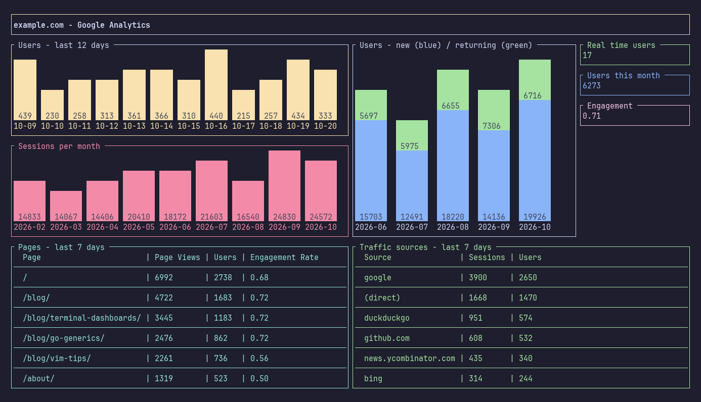

# Google Analytics 4

Display the data of a Google Analytics 4 property, with the [Google Analytics Data API](https://developers.google.com/analytics/devguides/reporting/data/v1).

Universal Analytics (the views and their `view_id`) was shut down by Google. If you come from upstream DevDash, see [Upgrading](../upgrading.md).

## Authorization

DevDash connects to Google with a service account and its JSON keyfile. You can use the same service account for [Google Search Console](./google-search-console.md).

### Create the service account and its keyfile

1. In the [Google Cloud console](https://console.cloud.google.com/), create a project, or select an existing one.
2. Enable the [Google Analytics Data API](https://console.cloud.google.com/apis/library/analyticsdata.googleapis.com) for this project.
3. Go to *IAM & Admin > Service accounts* and click *Create service account*. It doesn't need any role in the project.
4. Copy the email address of the service account, for example `devdash@my-project.iam.gserviceaccount.com`.
5. Open the service account, go to *Keys > Add key > Create new key*, and choose *JSON*. Keep the downloaded file: it's the keyfile.

### Give the service account access to your property

1. In [Google Analytics](https://analytics.google.com/), go to *Admin > Property access management*.
2. Add the email address of the service account, with the *Viewer* role.
3. Copy the ID of the property, in *Admin > Property details*: a number like `123456789`.

## Configuration

```yaml
services:
  google_analytics:
    keyfile: my-keyfile.json
    property_id: 123456789
```

| Option        | Description                                                                                         |
| ------------- | --------------------------------------------------------------------------------------------------- |
| `keyfile`     | Path of the JSON keyfile. A relative path is searched in the current directory, then in `$XDG_CONFIG_HOME/devdash`. |
| `property_id` | ID of the GA4 property. `properties/123456789` works too.                                           |

You can also set the keyfile with the environment variable `DEVDASH_GA_KEYFILE`.

## Widgets

| Widget                     | Type  | Description                                                                          |
| -------------------------- | ----- | ------------------------------------------------------------------------------------ |
| `ga.box_real_time`         | box   | Active users during the last 30 minutes                                              |
| `ga.box_total`             | box   | Total of a metric (`sessions` by default) for a period                               |
| `ga.bar`                   | bar   | Any metric over time, see `metric`, `dimensions` and `filters`                       |
| `ga.bar_sessions`          | bar   | Sessions over time                                                                   |
| `ga.bar_users`             | bar   | Users over time                                                                      |
| `ga.bar_returning`         | bar   | Returning users over time                                                            |
| `ga.bar_bounces`           | bar   | Bounces (sessions not engaged) over time                                             |
| `ga.bar_pages`             | bar   | Views over time of the pages whose path contains the `filters` (required)           |
| `ga.bar_countries`         | bar   | Sessions per country                                                                 |
| `ga.bar_new_returning`     | stacked bar | New and returning users' metric over time                                      |
| `ga.bar_devices`           | stacked bar | A metric over time, per device category (desktop, mobile, tablet...)           |
| `ga.table_pages`           | table | Metrics per page                                                                     |
| `ga.table_traffic_sources` | table | Metrics per traffic source                                                           |
| `ga.table`                 | table | Metrics per any dimension, see `dimension`                                           |

## Options

Every widget accepts `title`, and the [display options](../widgets.md#display-options) of its type.

| Option            | Description                                                                                                       | Default                       | Widgets                                                        |
| ----------------- | ----------------------------------------------------------------------------------------------------------------- | ----------------------------- | -------------------------------------------------------------- |
| `start_date`      | Beginning of the period, see [Dates](../dates.md)                                                                 | `7_days_ago`                  | Every widget except `box_real_time`                            |
| `end_date`        | End of the period                                                                                                 | `today`                       | Every widget except `box_real_time`                            |
| `global`          | `true` to ignore `start_date` and use all the data of the property                                               | `false`                       | `box_total`, bar widgets except the stacked ones, table widgets |
| `time_period`     | Period of each bar: `day`, `month` or `year`                                                                      | `day`                         | Bar widgets except `bar_countries`                             |
| `metric`          | The metric to display, see [Metrics](#metrics)                                                                    | `sessions`                    | `box_total`, `bar`, `bar_sessions`, `bar_new_returning`, `bar_devices` |
| `dimensions`      | Dimensions of the query, separated with commas, see [Dimensions](#dimensions)                                     |                               | `bar`                                                          |
| `filters`         | Values the dimension needs to contain, separated with commas. See [Filters](#filters).                           |                               | Bar widgets except `bar_returning` and the stacked ones, table widgets |
| `metrics`         | Columns of the table, separated with commas                                                                       | `sessions,page_views,users`   | Table widgets                                                  |
| `dimension`       | The dimension of the first column                                                                                 | `page_path`                   | `table_pages`, `table`                                         |
| `order`           | Order of the rows, separated with commas: a metric of `metrics` or the dimension, followed by `asc` or `desc`     | The first metric, `desc`      | Table widgets                                                  |
| `row_limit`       | Maximum number of rows                                                                                            | `5`                           | Table widgets                                                  |
| `character_limit` | Maximum number of characters of the first column                                                                  | `20`                          | Table widgets                                                  |

The values in the bars are integers: a rate like `bounce_rate` is better displayed in a box or a table.

### Metrics

You can use these aliases, or any [GA4 metric](https://developers.google.com/analytics/devguides/reporting/data/v1/api-schema#metrics) with its API name, like `metric: "engagementRate"` or `metric: "sessionsPerUser"`.

| Alias                      | GA4 metric                                                |
| -------------------------- | --------------------------------------------------------- |
| `sessions`                 | `sessions`                                                |
| `engaged_sessions`         | `engagedSessions`                                         |
| `page_views`               | `screenPageViews`                                         |
| `users`                    | `totalUsers`                                              |
| `new_users`                | `newUsers`                                                |
| `active_users`             | `activeUsers`                                             |
| `bounces`                  | `sessions` - `engagedSessions` (GA4 doesn't count bounces) |
| `bounce_rate`              | `bounceRate`                                              |
| `engagement_rate`          | `engagementRate`                                          |
| `session_duration`         | `averageSessionDuration` × `sessions`                     |
| `average_session_duration` | `averageSessionDuration`                                  |

### Dimensions

You can use these aliases, or any [GA4 dimension](https://developers.google.com/analytics/devguides/reporting/data/v1/api-schema#dimensions) with its API name, like `dimension: "city"`.

| Alias             | GA4 dimension     |
| ----------------- | ----------------- |
| `page_path`       | `pagePath`        |
| `landing_page`    | `landingPage`     |
| `referrer`        | `pageReferrer`    |
| `traffic_source`  | `sessionSource`   |
| `user_type`       | `newVsReturning`  |
| `device_category` | `deviceCategory`  |
| `country`         | `country`         |

### Universal Analytics names

The names of Universal Analytics, like `ga:pageviews` or `ga:userType`, are converted when GA4 has an equivalent. `entrances` and `unique_page_views` don't exist in GA4 anymore: they display an error.

### Filters

The `filters` select the rows whose dimension contains one of the values. A value beginning with `-` excludes the rows containing it instead. For example, `filters: "/blog/,-/blog/tag/"` keeps the pages containing `/blog/`, except the ones containing `/blog/tag/`. The comparison ignores the case.

The dimension filtered is:

* For `bar` widgets, the dimension of `dimensions`. The filters are ignored if there isn't exactly one dimension.
* For `bar_pages`, the page path. For `bar_countries`, the country.
* For table widgets, the dimension of the first column.

## Examples

```yaml
projects:
  - name: My blog
    services:
      google_analytics:
        keyfile: my-keyfile.json
        property_id: 123456789
    widgets:
      - row:
          - col:
              size: 6
              elements:
                - name: ga.bar_users
                  options:
                    start_date: 15_days_ago
                - name: ga.bar_sessions
                  options:
                    start_date: 12_months_ago
                    end_date: this_month
                    time_period: month
                    bar_width: 8
          - col:
              size: 4
              elements:
                - name: ga.bar_new_returning
                  options:
                    metric: users
                    height: 20
          - col:
              size: 2
              elements:
                - name: ga.box_real_time
                - name: ga.box_total
                  options:
                    title: " Users this year "
                    metric: users
                    start_date: this_year
                    end_date: today
      - row:
          - col:
              size: 6
              elements:
                - name: ga.table_pages
                  options:
                    title: " Pages - yesterday "
                    start_date: yesterday
                    end_date: yesterday
                    metrics: page_views,users,engagement_rate
                    row_limit: 10
                    character_limit: 40
          - col:
              size: 6
              elements:
                - name: ga.table
                  options:
                    title: " Cities "
                    dimension: city
                    metrics: users
                - name: ga.bar
                  options:
                    title: " Views of my blog posts "
                    metric: page_views
                    dimensions: page_path
                    filters: "/blog/,-/blog/tag/"
```

A complete dashboard is in [`example/google-analytics.yml`](../../example/google-analytics.yml) (screenshot with sample data):



More examples are in [Examples](../examples.md).
